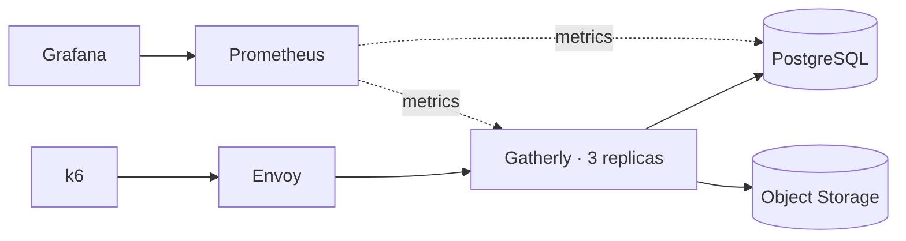

# Gatherly — compare load balancing algorithms

[Русский](README.md) | **English**

A test stand for comparing Envoy load balancing algorithms and their settings.
Configuration lives in a YAML profile in the repository. k6 sends concurrent
traffic to the event feed, personalized recommendations, and photo uploads.
Grafana shows request distribution, latency, and replica resource usage.



Follow the steps below to go from an empty cloud folder to a comparison of two runs.
GitHub Actions deploys the entire stand; you do not need to run the application on your computer.
You do not need to install the Yandex Cloud CLI (`yc`), Terraform, or Ansible locally.
Your computer only needs `openssl` and `ssh-keygen` to prepare credentials, and `ssh` to access Grafana.

[Project documentation](docs/README.en.md).

## 1. Create your repository

Open [Gatherly](https://github.com/dmgoldberg1/Gatherly) and click **Fork → Create fork**.
In your fork, open **Actions** and click **I understand my workflows, go ahead and enable them**.
Complete all subsequent GitHub steps in your fork, using the `main` branch.

## 2. Prepare Yandex Cloud

In the [Yandex Cloud console](https://console.yandex.cloud/), create a cloud linked
to an active billing account and an empty folder named `gatherly-bench`.
Save the cloud ID and folder ID for step 4.

This example needs **7 VMs**: three application replicas, Envoy, PostgreSQL,
monitoring, and k6. Before running the workflow, increase the cloud quotas to:

| Zone | VMs | vCPU | RAM | SSD |
| --- | --- | --- | --- | --- |
| `ru-central1-a` | 6 | 48 | 96 GiB | 120 GiB |
| `ru-central1-d` | 1 | 8 | 16 GiB | 20 GiB |

The overall cloud quotas must allow 7 VMs and 7 public IP addresses.

In the `gatherly-bench` folder, open **Identity and Access Management**:

1. Create a service account named `gatherly-ci`.
2. Assign it these roles **on the `gatherly-bench` folder**: `compute.editor`, `vpc.admin`,
   `iam.serviceAccounts.admin`, `iam.serviceAccounts.accessKeyAdmin`, `storage.admin`.
3. On the service account page, click **Create new key → Create authorized key**
   and download the JSON file.
4. Create a **static access key** on the same page. Save both values:
   the access key ID (`key_id`) and secret access key (`secret`).

These permissions let CI create resources within the dedicated folder.
[Yandex Cloud service account instructions](https://yandex.cloud/en/docs/iam/operations/sa/create).

Open **Object Storage** and create a bucket named `gatherly-state-<FOLDER_ID>`,
replacing the placeholder with your folder ID. Keep object access and object listing private.
Enable **versioning** in the bucket settings. GitHub Actions will store Terraform
state here between runs. The workflow creates the photo bucket itself.

## 3. Prepare the SSH key and passwords

Run these commands in a Linux/macOS terminal with `openssl` and `ssh-keygen` installed:

```bash
umask 077
mkdir -p ~/.gatherly-bench
ssh-keygen -t ed25519 -N '' -C gatherly-bench -f ~/.gatherly-bench/ssh-key
openssl rand -hex 32 | tr -d '\n' > ~/.gatherly-bench/db-password
openssl rand -hex 32 | tr -d '\n' > ~/.gatherly-bench/auth-secret
```

Save the downloaded service account JSON key as `~/.gatherly-bench/yc-key.json`.
Reuse these files for all subsequent runs of the same stand.

## 4. Configure GitHub Actions

In your fork, open **Settings → Secrets and variables → Actions**.
On the **Variables** tab, use **New repository variable** to add:

| Name | Value |
| --- | --- |
| `YC_CLOUD_ID` | The cloud ID from step 2 |
| `YC_FOLDER_ID` | The ID of the `gatherly-bench` folder |
| `YC_ZONE` | `ru-central1-a` |
| `BENCH_LOAD_ZONE` | `ru-central1-d` |
| `BENCH_STAND_NAME` | `gatherly-bench` |
| `BENCH_BUCKET` | `gatherly-media-<FOLDER_ID>`, with your folder ID substituted |
| `BENCH_STATE_BUCKET` | The name of the `gatherly-state-<FOLDER_ID>` bucket you created |
| `BENCH_PREEMPTIBLE` | `true` |

On the **Secrets** tab, use **New repository secret** to add:

| Name | Value |
| --- | --- |
| `YC_SA_KEY_JSON` | The entire contents of `~/.gatherly-bench/yc-key.json` |
| `BENCH_STATE_ACCESS_KEY` | The static access key's `key_id` from step 2 |
| `BENCH_STATE_SECRET_KEY` | The static access key's `secret` from step 2 |
| `BENCH_SSH_PRIVATE_KEY` | The entire contents of `~/.gatherly-bench/ssh-key`, including the BEGIN/END lines |
| `BENCH_DB_PASSWORD` | The contents of `~/.gatherly-bench/db-password`, exactly 64 characters |
| `BENCH_AUTH_SECRET` | The contents of `~/.gatherly-bench/auth-secret` |

Total: **8 variables and 6 secrets**. Keep the credential files on your computer.

## 5. Start the first run

Open **Actions → Gatherly cloud load benchmark → Run workflow**.
Select the `main` branch and fill in:

| Field | Value |
| --- | --- |
| `mode` | `deploy_and_test` |
| `config_file` | `bench/configs/one-minute.json` |
| `replicas` | `3` |
| `envoy_config_file` | `bench/envoy/round-robin.yaml` |

Leave the other fields unchanged and click **Run workflow**.
Wait for `cleanup_workspace → deploy → load_test` to finish.
The workflow builds the images, creates the VMs, applies migrations, and prepares the test data.

The run configuration is stored in [bench/configs/one-minute.json](bench/configs/one-minute.json):

```json
{
  "version": 1,
  "replicas": 3,
  "policy": "round_robin",
  "duration": "60s",
  "feed_rps": 50,
  "recommendations_rps": 30,
  "photo_upload_rps": 5,
  "photo_start_after": "15s",
  "seed": 42
}
```

`*_rps` is the target request rate for each scenario, `duration` is the run duration,
`photo_start_after` is the photo upload delay, and `seed` initializes the test data generator.
**Nonempty workflow inputs override the JSON; empty inputs retain the file's values.**
`envoy_config_file` selects an Envoy profile and takes precedence over `policy`.
The effective configuration is validated and saved in the `effective-config` artifact.

For recommendations, a past event with participation status `GOING` counts as
attended. Users with no history receive popular events.

## 6. Create your Envoy profile

In your fork, create `bench/envoy/my-algorithm.yaml` on the `main` branch:

```yaml
name: my-least-request
cluster:
  lb_policy: LEAST_REQUEST
  least_request_lb_config:
    choice_count: 4
```

This is a least request variant that selects from four candidates. The `cluster`
section accepts native Envoy settings; you do not need to edit an algorithm list in code.
Ready-made profiles: [random](bench/envoy/random.yaml), [ring hash](bench/envoy/ring-hash.yaml),
[maglev](bench/envoy/maglev.yaml), [weights 1:2:1](bench/envoy/weighted-round-robin.yaml).
[Profile format and custom Envoy extensions](docs/envoy-profiles.en.md).

Open **Run workflow** again, select `main`, and enter:

| Field | Value |
| --- | --- |
| `mode` | `update_config` |
| `config_file` | `bench/configs/one-minute.json` |
| `replicas` | `3` |
| `envoy_config_file` | `bench/envoy/my-algorithm.yaml` |
| `run_load_test` | Enabled |

Leave the other fields unchanged. Click **Run workflow** and wait for
`cleanup_workspace → update_config → load_test` to finish.

CI validates the profile using a real Envoy binary before cloud changes. Cluster
and route settings update through CDS/RDS without a restart; the database and buckets are preserved.
Before applying load, the workflow verifies the active settings and three healthy replicas.
Both runs use the same test data and request rates; the load balancing algorithm changes.

## 7. Compare the results

Open each completed run in **Actions**. In the `load_test` job summary, compare
successful RPS, p95, p99, errors, and `dropped_iterations` for the feed,
recommendations, and photos. Download `load-test-results` for the effective
configuration with the complete Envoy profile, k6 reports, and Envoy verification.

## 8. Open monitoring

In Yandex Cloud, open **Compute Cloud → Virtual machines → gatherly-bench-monitoring**
and copy its public IP address.

In **Virtual Private Cloud → Security groups → gatherly-bench**, add an inbound
rule: TCP, port `22`, source set to your computer's public IPv4 address followed by `/32`.
Find your current IPv4 address at [api.ipify.org](https://api.ipify.org).
The workflow configures SSH access for its runner; this rule adds access from your computer.

In your terminal, substitute the monitoring VM's IP address:

```bash
ssh -F /dev/null -i ~/.gatherly-bench/ssh-key \
  -N -L 13000:127.0.0.1:3000 ubuntu@<MONITORING_IP>
```

Keep the terminal open and visit [Grafana](http://localhost:13000/d/gatherly-bench).
Log in as `admin` using the contents of `~/.gatherly-bench/auth-secret` as the password.
Select the time range covering both runs on **Gatherly — нагрузочный стенд**
(the benchmark dashboard). It shows requests and CPU per replica, photo processing
queues, HTTP p99, and PostgreSQL load.

VMs and buckets remain in the cloud after the tests. When you finish experimenting,
open the settings of the cloud you created and select
[Delete cloud → Delete now](https://yandex.cloud/en/docs/resource-manager/operations/cloud/delete).
