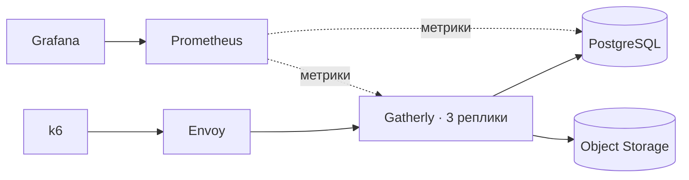

# Gatherly — сравнение алгоритмов балансировки

**Русский** | [English](README.en.md)

Стенд для сравнения алгоритмов и параметров балансировки Envoy. Настройки задаются
YAML-профилем в репозитории. k6 одновременно
нагружает ленту событий, персональные рекомендации и загрузку фотографий.
Grafana показывает распределение запросов, задержки и загрузку реплик.



Ниже — полный путь от пустого облачного каталога до сравнения двух прогонов.
Весь стенд разворачивается через GitHub Actions; приложение на компьютере запускать не нужно.
Yandex Cloud CLI (`yc`), Terraform и Ansible локально устанавливать не нужно.
На компьютере используются только `openssl`, `ssh-keygen` для подготовки ключей и `ssh` для Grafana.

[Документация проекта](docs/README.md).

## 1. Создай свой репозиторий

Открой [Gatherly](https://github.com/dmgoldberg1/Gatherly), нажми **Fork → Create fork**.
В своём форке перейди в **Actions** и нажми **I understand my workflows, go ahead and enable them**.
Все дальнейшие действия в GitHub выполняй в своём форке, ветка — `main`.

## 2. Подготовь Yandex Cloud

В [консоли Yandex Cloud](https://console.yandex.cloud/) создай облако с активным
платёжным аккаунтом и пустой каталог `gatherly-bench`. Сохрани ID облака и каталога:
они понадобятся в шаге 4.

Для этого примера нужны **7 VM**: три реплики приложения, Envoy, PostgreSQL,
мониторинг и k6. До запуска увеличь квоты облака до следующих значений:

| Зона | VM | vCPU | RAM | SSD |
| --- | --- | --- | --- | --- |
| `ru-central1-a` | 6 | 48 | 96 ГиБ | 120 ГиБ |
| `ru-central1-d` | 1 | 8 | 16 ГиБ | 20 ГиБ |

Суммарные квоты облака должны разрешать 7 VM и 7 публичных IP.

В каталоге `gatherly-bench` открой **Identity and Access Management**:

1. Создай сервисный аккаунт `gatherly-ci`.
2. Назначь ему роли **на каталог `gatherly-bench`**: `compute.editor`, `vpc.admin`,
   `iam.serviceAccounts.admin`, `iam.serviceAccounts.accessKeyAdmin`, `storage.admin`.
3. На странице аккаунта нажми **Создать новый ключ → Создать авторизованный ключ**
   и скачай JSON-файл.
4. Там же создай **статический ключ доступа**. Сохрани оба значения:
   идентификатор ключа (`key_id`) и секретный ключ (`secret`).

Эти права позволяют CI создавать ресурсы только в выделенном каталоге.
[Инструкция Yandex Cloud по сервисным аккаунтам](https://yandex.cloud/ru/docs/iam/operations/sa/create).

Перейди в **Object Storage** и создай бакет `gatherly-state-<FOLDER_ID>`,
подставив ID созданного каталога. Доступ к объектам и списку объектов — закрытый.
В настройках бакета включи **версионирование**. Здесь GitHub Actions будет хранить
Terraform state между запусками. Бакет фотографий создаст сам workflow.

## 3. Подготовь SSH-ключ и пароли

В терминале Linux/macOS выполни команды с установленными `openssl` и `ssh-keygen`:

```bash
umask 077
mkdir -p ~/.gatherly-bench
ssh-keygen -t ed25519 -N '' -C gatherly-bench -f ~/.gatherly-bench/ssh-key
openssl rand -hex 32 | tr -d '\n' > ~/.gatherly-bench/db-password
openssl rand -hex 32 | tr -d '\n' > ~/.gatherly-bench/auth-secret
```

Сохрани скачанный JSON-ключ сервисного аккаунта как `~/.gatherly-bench/yc-key.json`.
Эти файлы используй во всех последующих запусках того же стенда.

## 4. Заполни настройки GitHub Actions

В своём форке открой **Settings → Secrets and variables → Actions**.
На вкладке **Variables** через **New repository variable** добавь:

| Имя | Значение |
| --- | --- |
| `YC_CLOUD_ID` | ID созданного облака |
| `YC_FOLDER_ID` | ID каталога `gatherly-bench` |
| `YC_ZONE` | `ru-central1-a` |
| `BENCH_LOAD_ZONE` | `ru-central1-d` |
| `BENCH_STAND_NAME` | `gatherly-bench` |
| `BENCH_BUCKET` | `gatherly-media-<FOLDER_ID>`, с подставленным ID каталога |
| `BENCH_STATE_BUCKET` | Имя созданного бакета `gatherly-state-<FOLDER_ID>` |
| `BENCH_PREEMPTIBLE` | `true` |

На вкладке **Secrets** через **New repository secret** добавь:

| Имя | Значение |
| --- | --- |
| `YC_SA_KEY_JSON` | Полное содержимое `~/.gatherly-bench/yc-key.json` |
| `BENCH_STATE_ACCESS_KEY` | `key_id` статического ключа из шага 2 |
| `BENCH_STATE_SECRET_KEY` | `secret` статического ключа из шага 2 |
| `BENCH_SSH_PRIVATE_KEY` | Полное содержимое `~/.gatherly-bench/ssh-key`, включая строки BEGIN/END |
| `BENCH_DB_PASSWORD` | Содержимое `~/.gatherly-bench/db-password`, ровно 64 символа |
| `BENCH_AUTH_SECRET` | Содержимое `~/.gatherly-bench/auth-secret` |

Итого: **8 variables и 6 secrets**. Файлы с ключами и паролями остаются на твоём компьютере.

## 5. Запусти первый прогон

Открой **Actions → Gatherly cloud load benchmark → Run workflow**.
Выбери ветку `main` и заполни поля:

| Поле | Значение |
| --- | --- |
| `mode` | `deploy_and_test` |
| `config_file` | `bench/configs/one-minute.json` |
| `replicas` | `3` |
| `envoy_config_file` | `bench/envoy/round-robin.yaml` |

Остальные поля оставь без изменений и нажми **Run workflow**.
Дождись завершения цепочки `cleanup_workspace → deploy → load_test`.
Workflow сам соберёт образы, создаст VM, применит миграции и подготовит тестовые данные.

Конфиг прогона хранится в [bench/configs/one-minute.json](bench/configs/one-minute.json):

```json
{
  "version": 1,
  "replicas": 3,
  "policy": "round_robin",
  "duration": "60s",
  "feed_rps": 50,
  "recommendations_rps": 30,
  "photo_upload_rps": 5,
  "photo_start_after": "15s",
  "seed": 42
}
```

Здесь `*_rps` — целевое число запросов в секунду по каждому сценарию,
`duration` — длительность, `photo_start_after` — начало загрузок фото,
`seed` — начальное значение генератора тестовых данных.
**Заполненные поля формы переопределяют JSON, пустые берут значения из файла.**
`envoy_config_file` выбирает профиль Envoy и имеет приоритет над полем `policy`.
Итоговый конфиг проверяется и сохраняется в артефакте `effective-config`.

Для рекомендаций прошедшее событие со статусом участия `GOING` считается
посещённым; пользователи без истории получают популярные события.

## 6. Создай свой профиль Envoy

В своём форке создай файл `bench/envoy/my-algorithm.yaml` в ветке `main`:

```yaml
name: my-least-request
cluster:
  lb_policy: LEAST_REQUEST
  least_request_lb_config:
    choice_count: 4
```

Это вариант least request с выбором из четырёх кандидатов. Поле `cluster`
принимает нативные настройки Envoy; список алгоритмов в коде менять не требуется.
Готовые профили: [random](bench/envoy/random.yaml), [ring hash](bench/envoy/ring-hash.yaml),
[maglev](bench/envoy/maglev.yaml), [веса 1:2:1](bench/envoy/weighted-round-robin.yaml).
[Формат профиля и собственные расширения Envoy](docs/envoy-profiles.md).

Снова открой **Run workflow**, выбери `main` и заполни:

| Поле | Значение |
| --- | --- |
| `mode` | `update_config` |
| `config_file` | `bench/configs/one-minute.json` |
| `replicas` | `3` |
| `envoy_config_file` | `bench/envoy/my-algorithm.yaml` |
| `run_load_test` | Включено |

Остальные поля оставь без изменений. Нажми **Run workflow** и дождись завершения
`cleanup_workspace → update_config → load_test`.

CI проверит профиль настоящим Envoy до облачных изменений. Настройки кластера
и маршрута обновляются через CDS/RDS без перезапуска; БД и бакеты сохранятся.
Перед нагрузкой workflow проверит применённые параметры и три здоровые реплики.
В обоих прогонах одинаковые тестовые данные и темп запросов; меняется алгоритм балансировки.

## 7. Сравни результаты

Открой каждый завершённый запуск в **Actions**. В summary джоба `load_test`
сравни успешный RPS, p95, p99, ошибки и `dropped_iterations` для ленты,
рекомендаций и фотографий. Скачай артефакт `load-test-results`: в нём лежат
итоговый конфиг с полным профилем Envoy, отчёты k6 и результат проверки Envoy.

## 8. Открой мониторинг

В Yandex Cloud открой **Compute Cloud → Виртуальные машины → gatherly-bench-monitoring**
и скопируй публичный IP.

В **Virtual Private Cloud → Группы безопасности → gatherly-bench** добавь
входящее правило: TCP, порт `22`, источник — публичный IPv4 твоего компьютера с `/32`.
Текущий IPv4 можно посмотреть на [api.ipify.org](https://api.ipify.org).
Workflow настраивает SSH-доступ для своего runner; это правило добавляет доступ с твоего компьютера.

В терминале подставь IP VM мониторинга:

```bash
ssh -F /dev/null -i ~/.gatherly-bench/ssh-key \
  -N -L 13000:127.0.0.1:3000 ubuntu@<MONITORING_IP>
```

Оставь терминал открытым и перейди в [Grafana](http://localhost:13000/d/gatherly-bench).
Логин — `admin`, пароль — содержимое `~/.gatherly-bench/auth-secret`.
Выбери период обоих прогонов на дашборде **«Gatherly — нагрузочный стенд»**:
там видны запросы и CPU по репликам, очередь обработки фото, p99 HTTP и нагрузка PostgreSQL.

VM и бакеты остаются в облаке после завершения тестов. После экспериментов
открой настройки созданного облака и выбери
[Удалить облако → Удалить сейчас](https://yandex.cloud/ru/docs/resource-manager/operations/cloud/delete).
