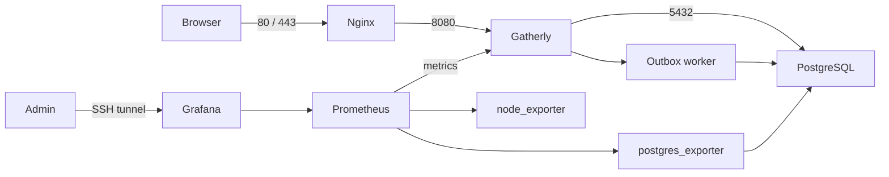

# Архитектура Gatherly

Gatherly — монолит для демонстрации C++, DevOps и SRE. Браузерный интерфейс
работает с REST API на Drogon; PostgreSQL хранит пользователей, подписки,
события, участия, уведомления и outbox.

Все компоненты работают в Docker Compose на одной VM. Terraform отвечает за VM,
IP и сеть; Ansible — за Docker, конфигурацию, миграции и запуск. Можно передать
существующую подсеть, если квота не позволяет создать новую VPC. Никакие IAM-роли
самому приложению не нужны. Статика остаётся внутри образа приложения.

## C++ и данные

- `ApiController` разбирает HTTP, `GatherlyService` проверяет бизнес-правила,
  `IPostgresStore` отделяет SQL от сервиса и позволяет тестировать его без БД.
- HTTP выполняется в четырёх рабочих потоках с очередью до 32 запросов.
  Блокирующие SQL и PBKDF2 не занимают event loop. Переполнение возвращает 503.
- Одно соединение libpqxx защищено mutex на время полной операции. Изменяющие
  операции дополнительно используют PostgreSQL advisory transaction lock:
  второй процесс приложения тоже соблюдает последовательность изменений.
  Это простой выбор для демо с низкой нагрузкой, ограничивающий throughput.
- Сервис задаёт транзакцию через `InTransaction`: публикация и записи outbox,
  capacity check и участие, выход и продвижение waitlist атомарны.
  Исключение до commit откатывает изменения. ID выдаёт PostgreSQL sequence.
- `001_init.sql` поддерживает прежнюю схему; `002_sequences.sql` поднимает
  sequences до существующих ID. `scripts/migrate.sh` применяет новые миграции
  под блокировкой и отмечает версии в `schema_migrations`. Работает и со старым volume.
- Соединение восстанавливается после отказа PostgreSQL. Connect, TCP и SQL timeouts
  ограничивают ожидание. Ошибки SQL возвращают 500 с общим сообщением.
- JSON разбирает nlohmann/json: Unicode и int64 сохраняются без потерь.
  Время событий нормализуется в UTC; сравниваются моменты времени, а не строки.
- Пароли и JWT описаны в [authentication.md](authentication.md).

## Outbox

Событие сначала коммитится вместе с outbox. После commit приложение пытается
доставить уведомления; встроенный поток повторяет обработку каждые две секунды.
Одна итерация берёт до 100 непройденных записей в порядке ID. Создание уведомлений
и перевод записей в PROCESSED коммитятся одной транзакцией. Перезапуск не создаёт
повторных уведомлений для уже завершённых записей.

Если SQL доставки падает, вся текущая партия откатывается и повторяется позже;
событие остаётся опубликованным. Ошибка видна в логах и
`notification_processing_errors_total`. FAILED и attempts отражают ошибки
демонстрационного канала `NotificationMode::FAILING` в сервисных тестах; публичного
HTTP-переключателя отказов нет. Постоянная ошибка одной записи задержит партию —
для этого есть метрика возраста очереди и alert. Внешние email/SMS не отправляются:
доставка означает создание строки `notifications`.

## Сохранённые правила

Публичная лента показывает PUBLISHED/PUBLIC. Лента подписок дополнительно показывает
FOLLOWERS_ONLY; PRIVATE доступно организатору и уже существующим участникам.
Адрес email остаётся частью публичного профиля, как в исходном API.
Выход GOING продвигает первого WAITLISTED. Смена статуса на MAYBE/DECLINED сама
по себе не продвигает очередь; изменение capacity не перераспределяет её.
Эти продуктовые правила сохранены, а не переопределены инфраструктурными правками.

`GET /me/events` возвращает все свои события, включая черновики и отменённые.
Интерфейс позволяет редактировать, отменять, публиковать сохранённый черновик и
читать уведомления. API поддерживает pagination; интерфейс, как и раньше,
загружает первые 100 записей списков — достаточно для демонстрационного стенда.

## Ограничения

Одна VM и локальные volumes — общая точка отказа. Обновление контейнера допускает
короткий downtime. Нет refresh tokens, email verification, HA или автоматического
failover. Бэкап на той же VM нужно копировать наружу, чтобы пережить потерю диска.
Миграции выполняются до запуска новой версии; rollback образа допустим только
при совместимости с текущей схемой.
