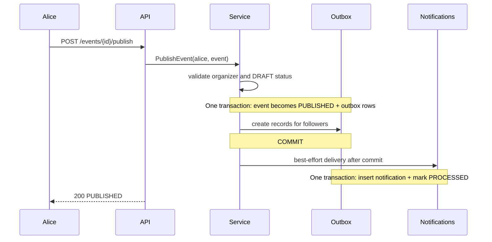
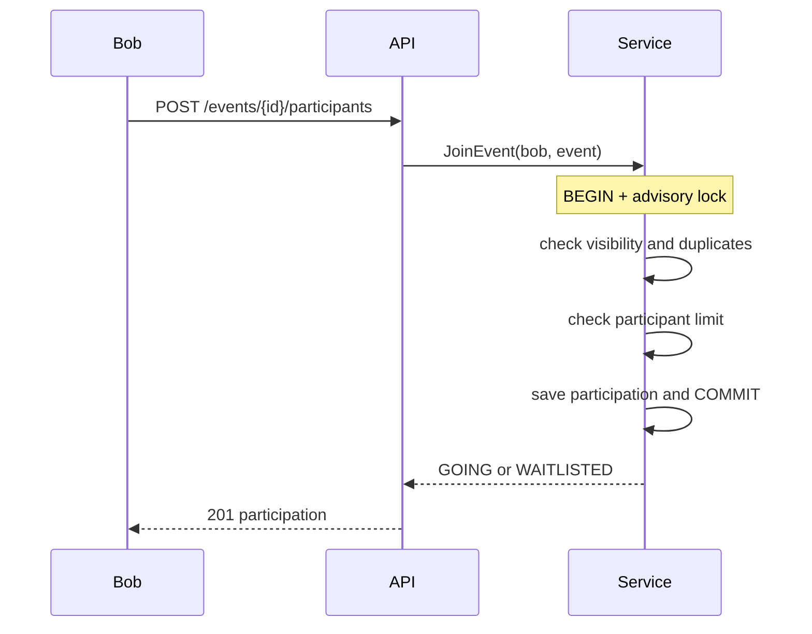
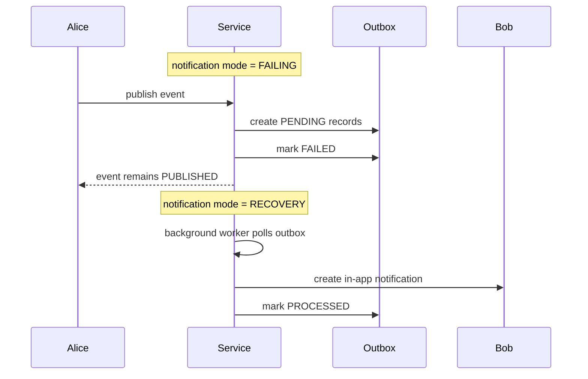

# Sequence diagrams

## Публикация события с созданием уведомлений

## Присоединение к событию

## Отказ уведомлений и повторная обработка

При SQL-ошибке доставки партия откатывается и повторяется worker; публикация
уже сохранена. FAILED/RECOVERY выше — режимы демонстрационного канала в сервисных
тестах, а не публичные HTTP-переключатели.
